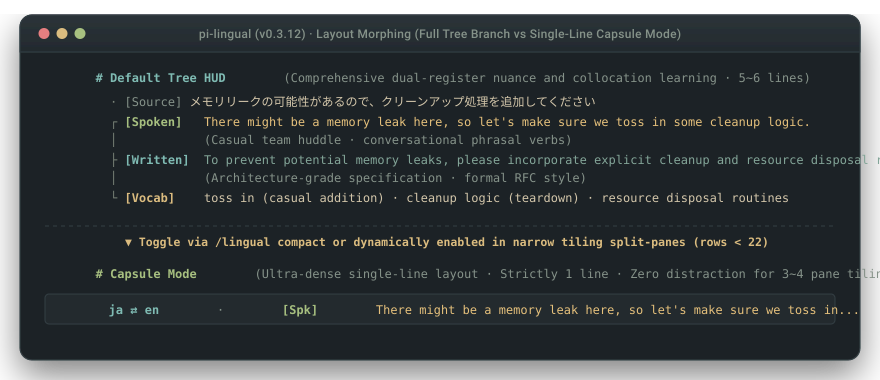

# pi-lingual

Pi Coding Agent 向けのターミナル二言語 HUD ＆ プロンプト変換エンジン。

母国語で思考してコーディング。入力欄のすぐ上（`aboveEditor`）にシリコンバレー現場の口語表現と RFC 品質の技術英語をリアルタイム表示し、必要に応じてプロンプトを標準的な技術英語へ自動変換することで、コード・コメント・コミットの英語統一を維持します。

[](https://www.npmjs.com/package/pi-lingual)
[](https://www.npmjs.com/package/pi-lingual)
[](https://github.com/3ZEROS12/pi-lingual/stargazers)
[](https://github.com/earendil-works/pi-coding-agent)
[-brightgreen)](tests/engine.test.ts)
[](LICENSE)

[English](./README.md) | **日本語** | [简体中文](./README_zh.md)

<p align="center">
  
</p>

```text
  · [原文]   メモリリークの可能性があるので、クリーンアップ処理を追加してください
  ┌ [Spoken]  There might be a memory leak here, so let's make sure we toss in some cleanup logic.
  ├ [Written] To prevent potential memory leaks, please incorporate explicit cleanup and resource disposal routines.
  └ [Vocab]   memory leak · toss in · resource disposal · incorporate
```

## クイックスタート

Pi 内で直接インストールできます：

```bash
pi install npm:pi-lingual
```

現在のセッションのモデル認証情報をそのまま利用するため、追加の API キー設定なしで即座に動作します。

---

## コアバリュー：なぜ pi-lingual が必要なのか？

ターミナルで AI コーディングエージェントを使う際、開発者は 4 つの具体的な課題に直面します：

### 1. OSS やグローバル開発リポジトリでの英語統一
OSS や多国籍チームでは、コード内コメント、コミットメッセージ、PR 説明文を英語で統一する必要があります。
母国語で AI に指示を出すと、コメントや説明まで母国語で生成されがちで、プッシュ前に手動で書き直す手間が発生します。
`english` モードでは、普段通り日本語で入力するだけで、`pi-lingual` がプロンプトを標準的な技術英語へ書き換えてからモデルへ渡します。**生成されるコード、コメント、ドキュメントが一貫してクリーンな英語に保たれます。**

### 2. コード生成を待つ 5〜15 秒の隙間時間を活用
Enter キーを押してから LLM がコードを生成するまでの 5〜15 秒間は、ブラウザに切り替えるには短すぎ、画面を眺めるだけになりがちです。
`pi-lingual` は入力欄のすぐ上（`aboveEditor`）に、日常のスタンドアップや Slack で使われる口語表現（`[Spoken]`）と、RFC や PR レビューで使われる技術文書表現（`[Written]`）を並べて表示します。待ち時間の視線移動だけで実践的な技術英語が身につきます。

### 3. コンテキスト汚染ゼロ・履歴トークン消費ゼロ
一般的な翻訳プラグインは、翻訳文をユーザープロンプトの末尾に追記して会話履歴に残します。
これではマルチターンの対話で履歴が肥大化し、トークン予算とモデルの推論精度を削ってしまいます。
`pi-lingual` は独立した TUI オーバーレイとして動作するため、**AI の会話履歴には翻訳用の余分なトークンを一切注入しません。**

### 4. 全角文字でも崩れないターミナルレイアウト
日本語や中国語などの東アジア全角文字（CJK）はターミナル上で 2 カラム幅を占めます。
従来の四方を囲むボックス罫線（`│ ... │`）は、文字幅計算のずれで右端の枠が割れ、折り返し崩れや残像を引き起こします。
`pi-lingual` は閉じ枠を廃し、Unicode UAX #11 文字幅計測に基づく左レール・ツリー構造（`· ┌ ├ └`）を採用しています。狭い tmux 分割ペインでも枠線が崩れません。

---

## 3 つの動作モード

`/lingual` コマンドでいつでも切り替え可能です：

```text
  /lingual （サイクル切り替え：original ➔ english ➔ off ➔ original）
```

| モード | 入力内容 | AI が受け取る内容 | 画面表示 | 適した場面 |
| :--- | :--- | :--- | :--- | :--- |
| **`original`** *(デフォルト)* | 母国語 *(日本語 / スペイン語 / 中国語など)* | **母国語のまま** *(0ms パススルー、履歴汚染ゼロ)* | 2 レジスタ二言語 HUD *(Spoken + Written + Vocab)* | 個人開発をしながら自然な英語表現を吸収したいとき |
| **`english`** *(英語変換)* | 母国語 *(日本語 / スペイン語 / 中国語など)* | **標準的な技術英語** *(RFC 品質の英語へ自動変換)* | 変換された英語のプレビューカード | 英語コメント・英語コミットが必須のチームや OSS 開発 |
| **`off`** *(オフ)* | 任意のテキスト | **入力テキストそのまま** *(バックグラウンド通信・UI ゼロ)* | 非表示 | UI オーバーレイなしでコーディングに集中したいとき |

### コードブロック＆エラースタックの完全保持
`english` モードでコード片やエラーログを貼り付けた場合、**コード部分は一切翻訳されません**：
- **自然言語の指示のみを変換**：冒頭の指示文だけを正確な技術英語へ書き換えます。
- **コードとログはそのまま結合**：元のコードブロックやスタックトレースを改変せず英語指示の後ろに再結合します。

---

## レイアウト形態：フルツリー vs 1 行カプセル

画面サイズに応じて 2 つの表示形態を使い分けられます：

<p align="center">
  
</p>

1. **左レール・ツリー HUD（デフォルト）**：Unicode UAX #11 に基づくオープンツリー表示（`· ┌ ├ └`）。ホスト側のウィジェット切り詰め警告を防ぐため、最大 9 行以内に厳密に制御されます。
2. **1 行カプセルモード（`/lingual compact`）**：HUD を高密度な 1 行ストリームに圧縮します：
   ```text
   ja ⇄ en · [Spk] There might be a memory leak... │ [Wrt] Incorporate explicit cleanup routines...
   ```
   *tmux や WezTerm の狭い分割ペインで縦スペースを 80% 以上節約します（ターミナルの高さが 22 行未満のときは自動適用）。*

---

## コマンド＆ショートカット

| コマンド | フルコマンド / 別名 | 説明 |
| :--- | :--- | :--- |
| `/lingual [sub]` | `/lingual-mode` | メインコマンド：モード切り替え、またはサブコマンド実行（例: `/lingual compact`） |
| `/slots [cmd]` | `/lingual-slots` | 動的スロット管理：カスタムスロットの追加・原文行の非表示（`/slots rm source`） |
| `/lingual-compact` | `/lingual compact` | ツリー HUD と 1 行カプセルモードの切り替え（Pi 本体の `/compact` と競合しません） |
| `/lang <source> [target]` | `/lingual-lang` | 言語ペアの切り替え（例: `/lang ja en`, `/lang en ja`, `/lang es en`） |
| `/last` | `/lingual-last` | 直前のコンパニオンカードを再表示 |
| `/lingual-model <id>` | — | 翻訳用モデルの指定（`auto` でセッション追従、または軽量モデル ID を指定） |
| `/status` | `/lingual-status` | 動作ステータス、使用中モデル、LRU キャッシュ統計の表示 |

*ショートカット：`Alt+.`（次のページ）、`Alt+,`（前のページ）。スタンドアロン CLI：`lingual "プロンプト"`。*

---

## 検証とテスト

```bash
npm run typecheck   # TypeScript 厳格型チェック (tsc --noEmit エラー 0)
npm test            # 自動テストスイート (93/93 アサーション通過)
npm run build       # tsup マルチエントリビルド (拡張機能 + コアエンジン)
```

---

## Ecosystem: Pi Terminal Suite

4 つの拡張機能はそれぞれ異なるターミナルスロット（`aboveEditor`、`belowEditor`、`status-only` フッター、実行時ツールフック）にマウントされるため、単体でも全種併用でも UI が干渉しません：

| パッケージ | ターミナル配置スロットと機構 | インストール |
| :--- | :--- | :--- |
| **[`pi-lingual`](https://github.com/3ZEROS12/pi-lingual)** *(現在)* | `二 ⇄ two` `aboveEditor` 二言語 HUD（最大 9 行・UAX #11 ツリーレイアウト）＆英語プロンプト変換（履歴トークン消費 0） | `pi install npm:pi-lingual` |
| **[`toolflow`](https://github.com/3ZEROS12/toolflow)** | `⌬` 実行時ツールフック —— フェーズ別 MCP マウント＆40 行超のログ自動ディスク退避（ログトークン 95% 削減） | `pi install npm:toolflow` |
| **[`pi-tui-status-beautifier`](https://github.com/3ZEROS12/pi-tui-status-beautifier)** | `status-only` フッターフック —— 6 種のバッジプリセット、`<80` 列での待機バッジ折りたたみ `(+N idle)`、描画ループ内ディスク I/O ゼロ | `pi install npm:pi-tui-status-beautifier` |
| **[`pi-anchor`](https://github.com/3ZEROS12/anchor)** | `⌖` `belowEditor` 1 行常駐付箋バー、0ms `pin:` インターセプト、ミニ進捗バー `[■■□□]` ＆ `↪` セッション復帰 | `pi install npm:pi-anchor` |

---

## ライセンス

MIT © [Jason Song](https://github.com/3ZEROS12)
