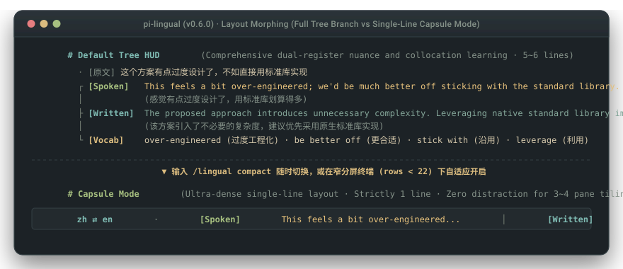
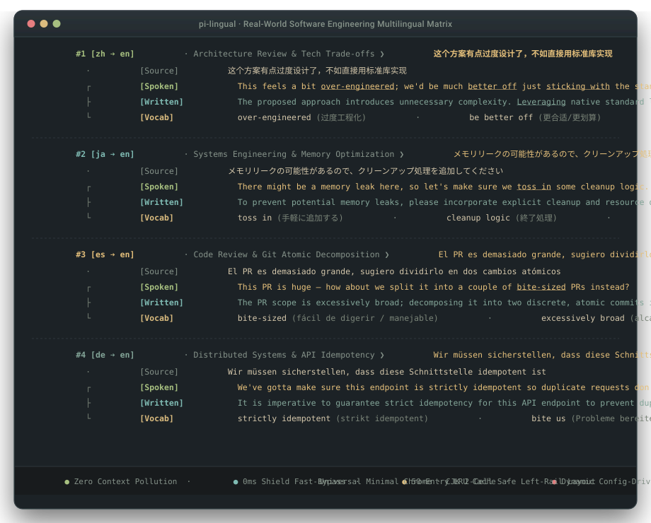

# pi-lingual

面向 Pi Coding Agent 的终端双语视窗与提示词转写引擎。

敲母语写代码。输入框上方实时显示地道技术口语与书面语；也可一键将提示词转写为规范技术英文，保持代码、注释与提交全英文规范。

[](https://www.npmjs.com/package/pi-lingual)
[](https://www.npmjs.com/package/pi-lingual)
[](LICENSE)
[](https://github.com/earendil-works/pi-coding-agent)
[-brightgreen)](tests/engine.test.ts)
[](tsconfig.json)

[English](./README.md) | **简体中文** | [日本語](./README_ja.md)

<p align="center">
  
</p>

```text
  · [原文] 这个方案有点过度设计了，不如直接用标准库实现
  ┌ [口语] This feels a bit over-engineered; we'd be much better off sticking with the standard library.
  │        (感觉有点过度设计了，用标准库划算得多)
  ├ [写作] The proposed approach introduces unnecessary complexity. Leveraging native standard library implementations is preferred.
  │        (该方案引入了不必要的复杂度，建议优先采用原生标准库实现)
  └ [重点] over-engineered (过度工程化) · be better off (更合适) · stick with (沿用) · leverage (利用)
```

## 一键安装

在 Pi 终端内运行：

```bash
pi install npm:pi-lingual
```

安装即可直接使用，自动跟随系统语言环境（缩写呈现为 `zh ⇄ en`、`ja ⇄ en` 等），冷启动零弹窗。默认直接调用当前会话的模型凭据，无需额外配置。

> 💡 **终端模式建议 (Terminal Mode)**：  
> `pi-lingual` 作为伴学与语感积累工具，建议在 `~/.pi/agent/settings.json` 中配置 `"tuiMode": "regular"`（传统滚动终端模式）。伴学卡片会自然随会话流留存在原生终端历史中，随时可以用鼠标滚轮向上回溯翻阅。
>
> ⚡ **延迟分层说明**：出厂默认纯伴学模式（Companion）下 0ms 原样直发，零排队延迟；改写类模式（规范直发与实战狂飙）按需进行单次模型调用，耗时随当前所选模型与网络波动。

---

## 核心价值：为什么需要它？

在终端中使用 AI 编写代码时，开发者每天都会遇到四个非常具体的痛点：

### 1. 团队与开源代码库必须是全英文
参与开源项目或跨国团队时，代码注释、Commit Message 和 PR 描述必须统一为纯英文。
用中文向 AI 提问，AI 很容易产出带有中文注释的代码或中文解释。每次提交前，你都得手动检查并修改一遍。
开启规范直发模式（`direct` / `lazy`）后：你在终端里用最习惯的母语随手提问，插件自动转写为专业技术英文下发给 AI。**AI 产出的代码、注释和说明天然保持统一的纯英文规范。**

### 2. 抓住大模型生成代码的 5 秒空隙
敲下回车后，大模型通常需要 5 到 15 秒来生成代码或重构逻辑。
这段时间很微妙：切出去刷网页太短，盯着屏幕发呆又容易走神。
`pi-lingual` 在输入框上方开辟了一个低认知负荷的语感视窗。利用等待代码生成的短暂间隙，一眼看清同一句话在日常站会（Slack/Standup）与正式技术规范（RFC/PR/Review）中的真实表达，顺手积累地道语感。

### 3. 零上下文污染，不浪费一个多余 Token
传统翻译工具通常把翻译文字追加在用户 Prompt 后面发给模型。
在多轮对话中，这会导致会话历史堆积大量冗余英文，白白浪费上下文预算，还会干扰长对话的推理焦点。
`pi-lingual` 运行在完全独立的 TUI 悬浮视窗中。**发给 AI 的输入保持纯净原文，不会向会话历史写入任何多余内容。**

### 4. 彻底解决终端排版撕裂
东亚全角字符（CJK）在终端中占据 2 个显示列宽。
常见的闭合四方框（`│ ... │`）一旦混入中文或特殊符号，字符测算失准就会导致边框断裂、重影和光标错位。
`pi-lingual` 放弃闭合边框，改用基于 Unicode UAX #11 的开放式树状布局（`· ┌ ├ └`）。无论分屏多窄，排版永不撕裂。

---

## 三核黄金预设与声明式模式架构 (`Mode as Configuration`)

`pi-lingual` 出厂预置**三核黄金基准模式**，并通过通用状态机引擎支持无限自定义。敲 `/lingual` 即可在已启用的模式与已关闭之间平滑循环轮转，或通过 `/lingual <id|序号>` 一步直达（提示：数字编号对应当前本地注册表顺序，而模式 ID 如 `/lingual companion`、`/lingual direct` 与 `/lingual live-flow` 永远有效解析）：

| 模式 | 核心命令与别名 | 你输入什么 | 引擎执行逻辑 | 底栏与界面反馈 | 适用场景 |
| :--- | :--- | :--- | :--- | :--- | :--- |
| **`[1] 纯伴学`** | `companion` *(别名: `original`)* | 任意母语 | **0ms 原样直发，提示词上方浮出双语对照卡** | 底栏 `zh ⇄ en · 纯伴学` + 四槽树状卡 | 把 AI 生成代码的 5-15 秒间隙，变成低负担的语感拾取窗口 |
| **`[2] 规范直发`** | `direct` *(别名: `lazy`)* | 母语输入 | **把口语化想法重构成祈使句工程指令** | 底栏 `zh ⇄ en · 规范直发` + 极简预览 | 回车即 1:1 规范英文，代码/注释/提交保持纯英文 |
| **`[3] 实战狂飙`** | `live-flow` *(别名: `raw`)* | 英文草稿 / 粗口狂飙 | **只修错词/介词/句法，保留粗口情绪，直发 Agent** | 底栏 `zh ⇄ en · 实战狂飙` + 自适应复盘卡 | 亲自坐上驾驶位直接飙外语，下方母语讲透盲点 |
| **`[0] 已关闭`** | `off` | 任意输入 | **隐藏底栏徽标 (`undefined`)、卸载终端监听、剥离技能块** | **0 像素、0 监听、0 Token**，彻底无痕 | 纯沉浸编码或录屏演示，不留任何视觉与上下文痕迹 |

---

### 零配置冷启动 (Zero-Config Cold Boot)
在新用户首次安装且缺少配置文件时，`session_start` 会自动嗅探系统原生语言环境，无需任何弹窗或设置对话：
- **自动对齐母语**：自动启用探测到的原生语言并以标准缩写对呈现（如 `zh ⇄ en`、`ja ⇄ en`）；
- **零磁盘写入契约**：首次启动不写入任何配置文件；仅当用户显式修改设置（通过 `/lang`、`/lingual`、`/slots` 或 `/tuner`）时才持久化落盘。

---

### 模式注册表管理与极客 CLI 命令 (`/lingual mode`)
用户不仅可以通过自然语言让 `lingual-tuner` 配置模式，也可以在终端直接传参操作：
- `/lingual mode list`：列出当前模式注册表、状态、流动方向与槽位数；
- `/lingual mode add <id> <name> [flow] [action] [hud]`：注册自定义工作流模式；
- `/lingual mode rm <id>`：删除指定模式；
- `/lingual mode toggle <id>`：临时停用/启用某个模式；
- `/lingual mode reset`：一键恢复双核黄金出厂预设。

---

### 四大战术配装库 (`/lingual loadout`)

除了出厂自带的双核预设，`pi-lingual` 提供 4 套专为高频编码场景调校的战术配装，敲一行命令即可装配，也支持通过 `/lingual tuner` 对话定制：

- **`spec`（脑暴压铸）**：`flow: "translate"` · `action: "transform"` · `target: "agent"` · `hud: "preview"`  
  中英杂乱思路 ➔ 压铸为「目标、硬约束、边界流、禁止修改模块」严谨规范，喂给 AI 的 Plan 模式打底。
- **`commit`（提交脱水）**：`flow: "translate"` · `action: "transform"` · `target: "clipboard"` · `hud: "preview"`  
  大白话修改说明 ➔ 自动提取差异转写为首行 $\le 72$ 字符、强动词开头的 Conventional Commits 规范，自动复制到剪贴板。
- **`oss`（开源对线）**：`flow: "translate"` · `action: "transform"` · `target: "clipboard"` · `hud: "tree"`  
  技术反驳与 Issue 讨论 ➔ 转为硅谷 Maintainer 平视、克制、对事不对人的行话（`nit:`, `under contention`, `repro:`），自动复制到剪贴板。
- **`yap`（极客发推）**：`flow: "translate"` · `action: "transform"` · `target: "clipboard"` · `hud: "tree"`  
  刚写完功能顺手甩出 ➔ 冷峻高密度 Indie Hacker 风格（$< 280$ 字符），0 Emoji 铁律，绝无微商软文，自动复制到剪贴板。

### 混合意图嫁接（代码与堆栈绝不乱翻）
在规范直发模式下，粘贴大段代码块或报错日志时，插件**绝不翻译代码**：
- **只翻人话**：仅提取指令前方的自然语言提问，转写为精准专业的技术英文（或当前配置的目标外语，实现全对等双向对称）；
- **原样拼接**：原始代码块、编译器诊断或报错堆栈 100% 原样保留，缝合在优化后的指令后方；
- **最终效果**：AI 收到地道规范的英文指令，同时拥有完整的代码与报错上下文。

---

## 交互实录：双语境视窗的设计哲学

死记孤立的单词表无法形成真实的表达能力。真实工程协作通常分化为两个截然不同的语境：

```text
  · [原文] 这个方案有点过度设计了，不如直接用标准库实现
  ┌ [口语] This feels a bit over-engineered; we'd be much better off sticking with the standard library.
  │        (感觉有点过度设计了，用标准库划算得多)
  ├ [写作] The proposed approach introduces unnecessary complexity. Leveraging native standard library implementations is preferred.
  │        (该方案引入了不必要的复杂度，建议优先采用原生标准库实现)
  └ [重点] over-engineered (过度工程化) · be better off (更合适) · stick with (沿用) · leverage (利用)
```

* **`[口语] (Spoken Register)`**：北美硅谷团队日常沟通的高频表达。包含站会交流、Slack 讨论、结对编程中的常用短语动词与口语俚语。
* **`[写作] (Written Register)`**：符合工程规范的技术书面语。适用于 RFC 提案、PR 描述、代码审查与技术方案编写。
* **`[重点] (Collocations)`**：动态提取的核心词汇与搭配。在口语和写作句中命中时，自动施加 ANSI 微光下划线高亮。

---

## 视窗形态：完整树状 vs 单行胶囊

针对不同开发分屏环境，提供两套视窗形态：

<p align="center">
  
</p>

1. **左导轨树状架构（默认）**：开放式单侧边框（`· ┌ ├ └`）。基于 Unicode UAX #11 计算列宽，窄分屏下也绝不断行重影；严格限制不超过 9 行，避免触发宿主终端小部件截断报错。
2. **单行胶囊模式（`/lingual compact`）**：将视窗压缩为单行高密度流：
   ```text
   zh ⇄ en · [口] This feels over-engineered... │ [写] Proposed approach introduces unnecessary complexity...
   ```
   *在 tmux、WezTerm 等窄分屏下节省 80% 纵向空间。当终端高度不足 22 行时自动生效。*

---

## 多语言真实场景对照

核心功能是将母语转为高阶英文，但也支持主流工程语言双向互转：

<p align="center">
  
</p>

| 源语言 | 场景 | 输入提示词 | [口语] 站会与交流 | [写作] RFC / PR 规范 |
| :--- | :--- | :--- | :--- | :--- |
| **🇨🇳 zh** | 架构评审 | `这个方案过度设计了，不如直接用标准库` | `This feels a bit over-engineered; let's stick with the standard library.` | `The proposed approach introduces unnecessary complexity. Leveraging native standard library implementations is preferred.` |
| **🇯🇵 ja** | 系统工程 | `メモリリークの可能性があるので、クリーンアップ処理を追加してください` | `There might be a memory leak here, so let's make sure we toss in some cleanup logic.` | `To prevent potential memory leaks, please incorporate explicit cleanup and resource disposal routines.` |
| **🇪🇸 es** | 代码审查 | `El PR es demasiado grande, sugiero dividirlo en dos cambios atómicos` | `This PR is huge — how about we split it into a couple of bite-sized PRs instead?` | `The PR scope is excessively broad; decomposing it into two discrete, atomic commits is advised.` |
| **🇩🇪 de** | 分布式系统 | `Wir müssen sicherstellen, dass diese Schnittstelle idempotent ist` | `We've gotta make sure this endpoint is strictly idempotent so duplicate requests don't bite us.` | `It is imperative to guarantee strict idempotency for this API endpoint to prevent duplicate mutations.` |

随时通过命令切换语言对：
```bash
/lingual lang ja en      # 日语转英语（或简写: /l lang ja en）
/lingual lang es en      # 西班牙语转英语
/lingual lang de en      # 德语转英语
/lingual lang en ja      # 英语转日语
/lingual lang zh ja      # 中文转日语
/lingual lang 日语       # 支持自然语言中文别名
```

**绝对母语主权（Language Sovereignty）**：切换母语后，底栏状态、命令说明、视窗标签、错误提示全部 100% 动态本地化，绝无硬编码残留。

---

## 底层硬核机制

- **智能语向传感器（0ms 自动放行）**：自动探测用户直接使用目标语言（如 `zh ⇄ en` 下键入英文）的书写行为，0ms 原样直发 coding agent，不走冗余跨语言翻译、零额外 Token 消耗；在规范直发模式下，以标准祈使动词（`Fix`, `Add`, `Refactor` 等）开头的规范工程提示词直接 0ms 放行。
- **交互式胶囊模式选择器**：只需在终端键入 `/lingual` 或超短别名 `/l`，即可原地展开高颜值胶囊条，按数字键 `1`/`2`/`3`/`0` 瞬间极速切换（无需按回车），也可通过方向键浏览高亮或按 `Esc` 安全取消。
- **输入流拦截**：在 `pass-through` 伴学模式下通过 `{ action: "continue" }` 实现 0ms 零延迟放行；在 `transform` 规范模式下通过 `{ action: "transform", text }` 动态重写提示词；在 `target: "clipboard"` 模式下自动写入系统剪贴板。
- **即时请求熔断**：敲回车或新输入到达时，单调递增世代令牌（Generation Token）立刻用 `AbortController` 物理掐断上一轮未完成的后台网络请求，杜绝幽灵响应与 Token 浪费。
- **零延迟清屏与避峰**：敲回车瞬间立即清空旧卡片，底栏切换为 `polishing...`；在 `pass-through` 伴学模式下请求延迟 80ms 触发，让出连接池给主任务完成首包握手，彻底免除排队互斥。
- **命令行与代码护盾**：40+ 常见 CLI 命令（`git`, `docker`, `npm`, `cargo`, `python`）及代码块以 0ms 直通放行，不耗费任何请求。
- **内存极速缓存**：内置 50 条 LRU 缓存，高频确认词（“继续”、“开始吧”、“认同”）0ms 瞬间直出。
- **输入审查与脱敏**：自动剥离剪贴板截图路径（`pi-clipboard-*.png`），折叠长堆栈报错与编译器诊断，提取核心自然语言。

---

## 双层认知模型：日常极简运用 + 深度配置全交 AI

`pi-lingual` 坚决践行**“用户只需掌握运用，配置全权交给 AI”**的设计哲学。你不需要成为 JSON 配置工程师，更不需要去死记硬背复杂的子命令参数：

### 1. 第一层：日常极简运用（3 秒掌握）
在日常编码中，你只需记住两个动作：
* **模式切换**：敲 `/lingual` 或超短别名 `/l`，原地弹出交互式胶囊面板，直接按数字键 `1`（纯伴学）、`2`（规范直发）、`3`（实战狂飙）、`0`（关闭），0ms 瞬间直达（也支持盲打 `/lingual 1`、`/lingual 2` 等）。
* **语言切换**：敲 `/lang ja` 或 `/lingual lang ja`，秒切目标外语。
* **智能放行**：敲母语正常呈现双语卡片，手顺敲纯英文（0 CJK）自动 0ms 放行直达 Agent，绝不硬翻。

### 2. 第二层：深度定制全权交给 AI（零手动配置负担）
任何个性化调整，**直接对你的 Pi Coding Agent 说人话**即可，内置的 `lingual-tuner` 顾问技能会自动安全组装并落盘：
* *“帮我配一个写 Conventional Commit 提交信息的模式”* ➔ 自动装配规范提交脱水配装；
* *“伴学卡片太长了，帮我精简成单行胶囊”* ➔ 自动切换视窗形态；
* *“把目标语言改成德语，重点词汇用中文解释”* ➔ 自动配置语向与解释语言；
* *“清理一下不用的模式，只留纯伴学和规范直发”* ➔ 自动读取现有配置并安全精简。

---

## 极简单一命令空间（全功能收拢于 `/lingual` 与 `/l`）

为保持 Pi `/` 补全菜单干净清爽，`pi-lingual` 严格仅注册 2 个第一公民命令（`/lingual` 及其超短别名 `/l`，并保留 `/lang` 作为友善别名）：

| 核心命令 | 子命令 / 传参 | 功能说明 |
| :--- | :--- | :--- |
| **`/lingual`** 或 **`/l`** | *(无参数)* | 呼出交互式胶囊模式选择器（按数字 `1`/`2`/`3`/`0` 瞬切，支持方向键与 `Esc`） |
| ↳ 序号直切 | `/lingual 1` \| `2` \| `3` \| `0` | 按位置序号或 ID 直切对应模式（`companion`, `direct`, `live-flow`, `off`） |
| ↳ 快捷开关 | `/lingual on` \| `off` | 快捷开启伴学或完全关闭（关闭态 0 像素、0 监听、0 Token 消耗） |
| ↳ 语言对切换 | `/lingual lang [pair]` 或 `/lang` | 切换伴学语言流向（如 `/lang ja`、`/lingual lang ja en`、`/lingual lang 日语`） |
| ↳ 认知卡回放 | `/lingual last` \| `replay` | 重新浮现上一条伴学或改写认知卡片 |
| ↳ 布局切换 | `/lingual compact` | 切换单行胶囊模式与开放式左导轨树状架构 |
| ↳ 思考深度 | `/lingual reasoning [low\|medium\|high]` | 调节模型推理思考深度（日常 `low` 快速响应（取决于模型提供商），结构化 `spec` 自适应 `medium`） |
| ↳ 模式防漂移 | `/lingual lock` \| `unlock` | 锁定会话模式防外部脚本漂移（人类敲数字或面板点选永远 100% 优先响应） |
| ↳ 架构师向导 | `/lingual tuner [自然语言需求]` | 直接唤醒双语架构师向导，对话式定制模式与提示词 |
| ↳ 运行报告 | `/lingual status` | 查看当前语言流向、模型、布局状态与内存缓存命中率 |

*快捷键：`Alt+.`（下一页），`Alt+,`（上一页）。系统独立命令行：`lingual "输入需求"`。*

---

## 全动态槽位流水线（所有槽位完全可动）

伴学卡片的每个槽位（包括原文）都是独立可插拔的构件，不强制绑定任何固定模板：

- **不喜欢回显原文行**：  
  运行 `/lingual slots rm source` 物理移除原文槽位。卡片不占用顶行空间，直接渲染紧凑译文分支。
- **添加自定义风格槽位**：  
  运行 `/lingual slots add twitter 推文 Short punchy tweet under 280 chars`。系统提示词输出结构与 HUD 树状图实时同步适配。
- **一键开关与恢复初始**：  
  运行 `/lingual slots toggle <id>` 临时静音指定槽位；运行 `/lingual slots reset` 恢复初始槽位。

> 💡 **Agent 交互规范**：Agent 在协助你配置或优化伴学风格时，会主动向你确认两件事：**期望的槽位数**，以及**每个槽位具体想要的功能风格（包括是否保留原文）**，按你的真实习惯组装流水线。

---

## 独立模型分流与隐私

### 可配置思考深度 (`/lingual reasoning`)
无需为不同任务频繁切换模型，`pi-lingual` 支持声明式调节每个模式的推理思考深度（Reasoning Effort）：
```bash
/lingual reasoning low       # 低延迟快速执行（取决于模型提供商），适合日常规范直发与实战狂飙
/lingual reasoning medium    # 深度结构化推演，适合复杂工程规范压铸（Brain-Dump to Spec）
/lingual reasoning high      # 高难度多约束场景深度推理
```
- 日常模式（`direct`/`lazy`、`live-flow`/`raw`、`commit`、`oss`、`yap`）出厂默认 `"low"`，兼顾敏捷响应（取决于模型提供商）；
- 结构化压铸配装（`spec`）出厂默认 `"medium"`，确保目标、约束边界与勿碰模块逻辑缜密、零幻觉。

### 保护主力模型额度
默认自动复用当前 Pi 会话凭证，零配置开箱即用。

如果主任务在使用高配长思考主力模型，可将伴学转写交给环境中的轻量高速模型，保护昂贵的主力推理配额：
```bash
/lingual model <轻量模型ID>   # 指定环境中的任意轻量高速模型
/lingual model auto          # 恢复跟随当前会话主模型
```

也支持在 `~/.pi/agent/lingual.json` 中配置本地 Ollama 或私有兼容端点：
```json
{
  "endpoint": "http://127.0.0.1:11434/v1/chat/completions",
  "model": "qwen2.5:3b"
}
```

> 🔒 **绝对隐私承诺**：`pi-lingual` **零外部依赖**（`dependencies: {}`），零遥测，不上传任何隐私数据。仅与你配置的模型端点通信。

---

## 作者手记 (Author's Note)

翻译模型的 Prompts 目前是我预先定制好的，但大家完全可以通过我们提供的 `/lingual tuner` 命令或内置的 `lingual-tuner` 技能，针对各自的具体情况进行深度个性化定制。

不仅局限于此，大家尽可能真的好好考虑自己想要的输出效果到底是什么：
* **需要多细的颗粒度去分解句子里的重点短语？**
* **是否需要针对特定的语法或工程语境额外增加用法讲解？**
* **提取几个核心搭配最适合自己的认知负荷？**

这些都是很重要的，只有用心调整了，才能达到更好的效果。在终端里敲完回车、等待 AI 生成代码的日常间隙中，顺便多看一眼屏幕上方浮现的地道表达。

启发我这个工具灵感的，可能源于我之前使用水杉输入法等项目的切身经历。我切实地用了很长一段时间，但结果并不是很好，感觉并没有真正学到什么：简单的词汇平时本就熟悉，不用重复学习；而真正困难生僻的词汇，脱离了真实语境光看孤立的词条也学不明白，那段时间我的词汇软件都快被翻烂了。真正能让人自然内化并能脱口而出的，永远是完整语境下的地道表达与真实搭配。

希望大家能用心调出最适合自己的提示词，日常多看一眼，坚持下去吧。

---

## 质量验证与构建

```bash
npm run typecheck   # TypeScript 严格类型检查 (0 错误)
npm test            # 全套自动化单元测试 (178/178 全绿通过)
npm run build       # 多入口生产构建 (插件 + 核心语言引擎)
```

---

## 生态协同：Pi 终端与桌面套件

每个工具均占用互斥的终端或桌面插槽，协同运行零干扰：

| 工具包 | 运行环境与插槽 | 机制与职责 | 安装 / 链接 |
| :--- | :--- | :--- | :--- |
| **[`pi-lingual`](https://github.com/3ZEROS12/pi-lingual)** *(当前)* | 终端 `aboveEditor` 视窗 | 双语双寄存器伴学卡片（≤9 行，UAX #11 树状）与 0-token 提示词规范化 | `pi install npm:pi-lingual` |
| **[`lingual-desktop`](https://github.com/3ZEROS12/lingual-desktop)** | Windows 桌面极简灵动岛 | 底层低级键盘钩子（`WH_KEYBOARD_LL`），顶部原位 3 秒卡片与全局输入桥接 | [GitHub Release](https://github.com/3ZEROS12/lingual-desktop/releases) |
| **[`toolflow`](https://github.com/3ZEROS12/toolflow)** | 终端工具沙箱 | 阶段门控工具挂载与 >40 行冗长日志落盘脱水（-95% 上下文消耗） | `pi install npm:toolflow` |
| **[`pi-tui-status-beautifier`](https://github.com/3ZEROS12/pi-tui-status-beautifier)** | 终端底部状态栏 | 6 套预设徽章，`<80` 列静默折叠（`+N idle`），0 渲染循环读盘开销 | `pi install npm:pi-tui-status-beautifier` |
| **[`pi-anchor`](https://github.com/3ZEROS12/anchor)** | 终端 `belowEditor` 便签条 | 1 行常驻便签，0ms `pin:` 拦截，`[■■□□]` 进度条与 `↪` 会话跳转 | `pi install npm:pi-anchor` |

---

## 开源协议

MIT © [Jason Song](https://github.com/3ZEROS12)
